

# Samy Tamim

Software Engineering Student · **42 Paris**
 
Data & AI Specialization · Level **20.46 / 21**

## 🏅 Certifications

<!-- CREDLY-BADGES:START -->
_Badges sync automatically after certification._
<!-- CREDLY-BADGES:END -->

## **🛠 Stack**

 

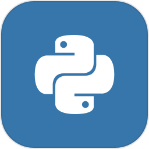&nbsp;&nbsp;&nbsp;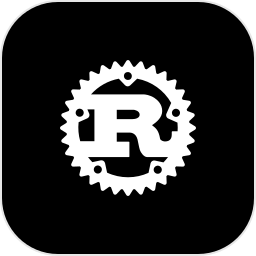&nbsp;&nbsp;&nbsp;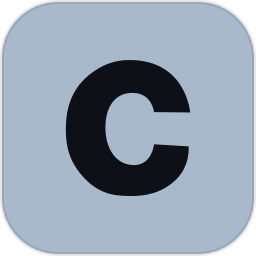&nbsp;&nbsp;&nbsp;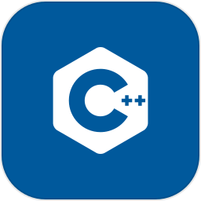&nbsp;&nbsp;&nbsp;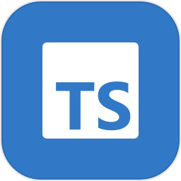&nbsp;&nbsp;&nbsp;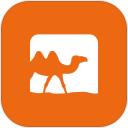&nbsp;&nbsp;&nbsp;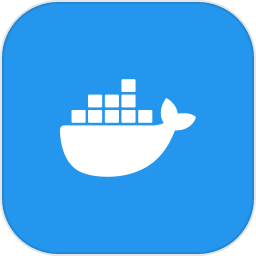&nbsp;&nbsp;&nbsp;&nbsp;&nbsp;&nbsp;

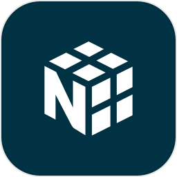&nbsp;&nbsp;&nbsp;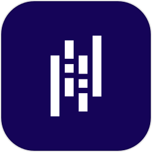&nbsp;&nbsp;&nbsp;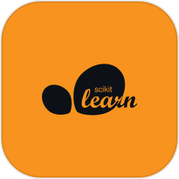&nbsp;&nbsp;&nbsp;&nbsp;&nbsp;&nbsp;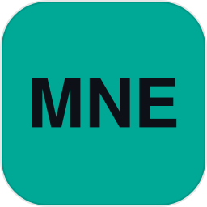&nbsp;&nbsp;&nbsp;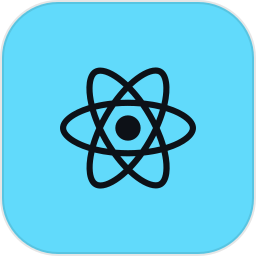

## 🧠 Cursus Projects

 

| Category          | Project                                                                                | Topic                                                    |                                             Lang                                                             | Status |    Mark     |
| :-------          | :------------------------------------------------------------------------------------- | :------------------------------------------------------- | :------------------------------------------------------------------------------------------:                 | :----: | :---------: |
|Math   | [`matrix`](https://github.com/mylastresort/matrix)                                     | Matrix decompositions · _Linear Algebra_                 |                        |   ✅    | **125/100** |
|AI & Data   | [`tweets`](https://github.com/mylastresort/tweets)                                     | Sentiment analysis · _NLP_                               |                  |   ✅    | **121/100** |
|AI & Data   | [`total-perspective-vortex`](https://github.com/mylastresort/total-perspective-vortex) | Motor imagery classification · _BCI / Signal Processing_ |                  |   ✅    | **96/100**  |
|AI & Data   | [`churn`](https://github.com/mylastresort/churn)                                       | Churn classification · _Deep Learning_                |                  |   ✅    | **113/100** |
|AI & Data   | [`multilayer-perceptron`](https://github.com/mylastresort/multilayer-perceptron)       | Backpropagation from scratch · _Deep Learning_           |                        |   ✅    | **125/100** |
|AI & Data   | [`myspotify`](https://github.com/mylastresort/myspotify)                               | Music recommendation · _Recommender Systems_             |                  |   ✅    | **100/100** |
|DevOps             | [`Inception`](https://github.com/mylastresort/Inception)                               |Docker Compose infrastructure · _Containerization_        |                  |   ✅    | **100/100** |
|DevOps             | [`inception-of-things`](https://github.com/archer-01/inception-of-things)              |Kubernetes clusters · _Orchestration_                     |      |   ✅    | **125/100** |
|Computer Graphics  | [`miniRT`](https://github.com/mylastresort/miniRT)                                     |Ray tracing renderer · _3D Rendering_                     |                                 |   ✅    | **105/100** |
|Compiler Theory    | [`ft_turing`](https://github.com/mylastresort/ft_turing)                               |Turing machine simulator · _Automata Theory_              |                     |   ✅    | **125/100** |
|Web Development               | [`ft_transcendence`](https://github.com/mylastresort/ft_transcendence)                 |Multiplayer online game · _Real-time Web App_                 |      |   ✅    | **100/100** |
|Game AI            | [`gomoku`](https://github.com/mylastresort/gomoku)                                     | AI game with minimax · _Game AI_                         |      |   ✅    | **125/100** |
|Web Development    | [`hypertube`](https://github.com/mylastresort/hypertube)                               |Movie Web App · _HLS Streaming_                      |      |   ✅    | **125/100** |
|Systems Programming| [`taskmaster`](https://github.com/mylastresort/taskmaster)                             |Process control system · _Process Management_             |                              |   ✅    | **125/100** |

